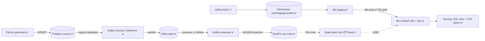

# Gaming Lakehouse Pipeline

End-to-end data platform for a gaming-industry use case: which player
segments and game titles drive revenue, and where do early churn signals
show up in the session/purchase funnel. Built incrementally, phase by
phase — this delivery covers **Phase 1: Walking Skeleton** (on top of the
Phase 0 infrastructure), plus an early Superset dashboard. See [`docs/PROJECT_PLAN.md`](docs/PROJECT_PLAN.md) for the full
problem statement, data model, and phase roadmap.

## Architecture

✅ = implemented in Phase 1 · 📋 = planned (later phase)



Detailed data-flow diagram (icons, formats, parsing per stage): [`docs/architecture/architecture.png`](docs/architecture/architecture.png) (editable source: [`architecture.drawio`](docs/architecture/architecture.drawio)).

Component roles (pipeline ↔ component mapping):

| Pipeline role | Component |
|---|---|
| Source system #1 (events) | Python generator → source Postgres (`source.game_events`) |
| Source system #2 (catalog) | FreeToGame public API → Airflow task `fetch_games_api` (ADR 0003) |
| Ingestion / CDC | Debezium (Kafka Connect) streaming into Kafka |
| Streaming buffer | Kafka topic `gaming.source.game_events` |
| Raw landing zone | RustFS bucket (`raw/game_events/dt=<date>/`) — orchestrated consumer task |
| Warehouse (raw/staging/curated/serving) | ClickHouse + dbt-clickhouse (tests act as the DQ gate) |
| Batch compute | Spark — connectivity proof now, real S3A job in Phase 3 (ADR 0001) |
| Orchestration | Airflow `gaming_pipeline` DAG (logical-date parameterised) |
| Serving | `serving.v_player_engagement_daily` and `serving.v_game_revenue` SQL views + CSV reports on RustFS |
| Dashboard | Apache Superset (auto-refresh charts on ClickHouse) |
| Consumer | Product/Growth team — any SQL client/BI tool; reproducible via repo init SQL |

Full component-by-component walkthrough: `docs/PROJECT_PLAN.md`, section 3.

## Tech Stack

| Layer | Technology |
|---|---|
| Source database | PostgreSQL 16.4 (`wal_level=logical`) |
| Change data capture | Kafka Connect + Debezium PostgreSQL connector 2.7.3 |
| Streaming backbone | Apache Kafka 3.8.0 (KRaft mode) |
| Kafka observability | Kafka UI (Provectus) 0.7.2 |
| Raw object storage | RustFS 1.0.0 (S3-compatible) |
| Warehouse | ClickHouse 24.8 (columnar, ReplacingMergeTree raw) |
| Transformation (dims/facts) | dbt-core 1.8.7 / dbt-clickhouse |
| Batch processing (aggregates) | Apache Spark 3.5.3 (standalone master+worker) |
| Orchestration | Apache Airflow 2.10.2 |
| Containerization | Docker Compose |

Full justification and rejected alternatives: `docs/PROJECT_PLAN.md`, section 4.

## Prerequisites

- Docker + Docker Compose v2
- Python 3.11+
- ~8 GB free RAM for the local stack (2x Postgres, ClickHouse, Kafka, Kafka
  Connect, RustFS, Spark master+worker, Airflow webserver+scheduler, Superset)

## Setup

```bash
git clone <repo-url> && cd gaming-data-pipeline-e2e
cp .env.example .env
# .env.example ships working LOCAL-DEV sample values - no edits needed to run.
# Change them for any shared deployment. Never commit .env.

# First `up` also BUILDS the custom Airflow image (orchestration/Dockerfile.airflow,
# adds dbt + kafka client + boto3 + docker SDK to the stock Airflow image) —
# expect a few of extra minutes on the first run only.
docker compose -f infra/docker-compose.yml --env-file .env up -d
docker compose -f infra/docker-compose.yml --env-file .env ps   # wait for all services "healthy"

# Register the Debezium PostgreSQL source connector (idempotent — safe to re-run)
make register-connector

# After the FIRST pipeline run (`make smoke`, see below) create the Superset
# dashboard - its datasets read tables that only exist once the pipeline ran.
# Idempotent: safe to re-run any time.
# make seed-superset
```

- **Control panel: http://localhost:8099** (`make portal`) — one page with every service link, a health dot and copyable credentials (generated from `.env`, bound to localhost only)
- Airflow UI: http://localhost:8080 (credentials: `AIRFLOW_ADMIN_USER` / `AIRFLOW_ADMIN_PASSWORD` from `.env`)
- RustFS console: http://localhost:9001
- Spark master UI: http://localhost:8081
- Kafka Connect REST API: http://localhost:8083
- Kafka UI: http://localhost:8085
- Superset (dashboard): http://localhost:8088 (credentials: `SUPERSET_ADMIN_*` from `.env`)
- ClickHouse HTTP: `localhost:8123` (native: `localhost:9004`)
- Postgres (source): `localhost:5433`, database from `SOURCE_POSTGRES_DB`
- Kafka broker: `localhost:9092`

Local Python environment, for running the generator or tests outside Docker:

```bash
python3 -m venv .venv && source .venv/bin/activate
pip install -r requirements.txt
PYTHONPATH=. pytest -q
```

## Run the Pipeline (Phase 1)

The batch slice (Kafka → RustFS → raw → staging → curated → serving) runs
**inside Airflow** as the `gaming_pipeline` DAG. The generator + CDC stream
continuously and independently; Airflow owns everything from the topic onward.

```bash
# 1. Seed the source with synthetic events (the "source system" writing its OLTP table)
make generate COUNT=5000          # or: make generate-forever

# 2. Trigger the DAG for a specific logical date (Airflow UI or CLI)
docker exec gaming-airflow-scheduler airflow dags unpause gaming_pipeline
docker exec gaming-airflow-scheduler airflow dags trigger \
  gaming_pipeline -e 2026-10-09T00:00:00+00:00   # -e = the logical date the run is FOR

# 3. Or run the whole loop + verification as one command:
make smoke                        # seeds 5000 events, triggers for today, verifies all layers
SMOKE_DS=2026-10-09 SMOKE_COUNT=5000 make smoke   # explicit logical date
```

DAG shape (each stage a separate task, explicit dependencies):

```
land_raw_kafka_to_rustfs ─▶ load_raw_to_clickhouse ─┐
fetch_games_api ─▶ load_games_to_clickhouse ────────┴─▶ dbt_run_staging ─▶ dbt_test_staging ─▶ dbt_run_curated ─▶ publish_serving
spark_connectivity_proof (parallel — Spark integration proof, see docs/decisions/0001)
```

**Expected result:** the run reaches `success`; the layer row counts from
the smoke test reconcile (staging is 1:1 with raw; the fact equals its
staging slice; the difference is documented dirty rows flagged to NULL, not
dropped). Sample per-layer verification:

```bash
# raw + staging + curated + serving (warehouse)
docker exec gaming-clickhouse clickhouse-client --query "
  SELECT 'raw' layer, count(*) FROM gaming_lakehouse.raw.game_events
  UNION ALL SELECT 'staging', count(*) FROM gaming_lakehouse.staging.stg_game_events
  UNION ALL SELECT 'fct', count(*) FROM gaming_lakehouse.curated.fct_in_game_transaction
  UNION ALL SELECT 'serving', count(*) FROM gaming_lakehouse.serving.v_player_engagement_daily"

# raw objects in RustFS (dt=<logical date> partitions)
aws --endpoint-url http://localhost:9000 s3 ls s3://raw-game-events/raw/game_events/ --recursive

# serving CSV report (exported, consumer-visible artifact)
aws --endpoint-url http://localhost:9000 s3 ls s3://raw-game-events/serving/player_engagement_daily/ --recursive
```

**Idempotency / re-runs:** re-running the same logical date creates no
duplicates — raw objects are keyed by Kafka offset range (overwritten),
raw rows land in a ClickHouse `ReplacingMergeTree` ordered by
`(source_partition_date, event_id)` (staging reads with `FINAL`, so duplicates
are invisible downstream), curated models are full-refresh tables, serving is `CREATE OR REPLACE VIEW` + deterministic
report key. Different logical dates coexist (`source_partition_date` /
`dt=<date>` partitions).

**Restart persistence:** `make down` + `make up` keeps all named volumes —
previous results are still there and the pipeline runs again.

**Deliberate failure demo** (documented for reviewers):

```bash
PIPELINE_FAIL_SWITCH=1 make up   # recreate Airflow with the failure switch on
make smoke                       # run fails at land_raw_kafka_to_rustfs (AirflowFailException),
                                 # all downstream tasks are skipped, run marked failed
PIPELINE_FAIL_SWITCH=0 make up   # back to normal
```

**API outage demo:** set `FREETOGAME_API_URL=http://127.0.0.1:1/x` in `.env`, `make up`, trigger the DAG —
`fetch_games_api` retries 3× then fails, downstream tasks are skipped, the run is marked failed.

**Retries:** the Kafka ingestion task retries twice and the games-API task three times (1-minute delay);
all other tasks retry twice (default_args).

**Where to look for logs:** Airflow UI → `gaming_pipeline` → task logs
(each task logs start/end, input/output locations, rows read/written), or
`docker logs gaming-airflow-scheduler`. Smoke prints the per-layer table to
stdout. See `docs/evidence/phase-1.md`.

## Stopping / Restarting Infrastructure

```bash
make down    # stop, keep data (named volumes persist)
make up      # restart — state (Postgres, ClickHouse, Kafka log, RustFS objects) survives
make clean   # full reset — deletes all volumes/state
```

## Project Structure

```
.
├── docs/
│   └── PROJECT_PLAN.md              # full plan: problem, data model, pipeline design, DQ, roadmap
├── infra/
│   ├── docker-compose.yml           # source postgres, clickhouse, kafka, kafka-connect, rustfs, spark, airflow, superset
│   ├── clickhouse/init.sql          # creates raw / staging / curated / serving databases on first boot
│   ├── superset/superset_config.py  # Superset configuration
│   ├── postgres-source/init.sql     # creates source.game_events OLTP table watched by Debezium
│   └── kafka-connect/
│       ├── postgres-source-connector.json  # Debezium PostgreSQL connector config
│       └── register-connector.sh           # registers the connector against the Connect REST API
├── ingestion/
│   ├── schemas.py                   # dataclasses for the reduced gaming entity set
│   ├── producer/
│   │   ├── generator.py             # synthetic event generator (dirty data + schema drift)
│   │   └── db_writer.py             # CLI: writes generated events into Postgres source.game_events
│   └── consumer/
│       └── kafka_to_rustfs.py       # CLI: consumes the CDC topic, lands NDJSON batches in RustFS
├── orchestration/
│   └── dags/gaming_pipeline_dag.py  # gaming_pipeline DAG (ingest -> raw -> dbt staging/test/curated -> serving)
├── transformation/
│   ├── dbt_gaming/                  # dbt project: staging model, curated dim_player + fct_in_game_transaction
│   └── spark_jobs/
│       └── daily_engagement_batch.py  # Spark batch job skeleton: RustFS -> agg_player_daily_engagement
├── config/
│   └── settings.py                  # single source of truth for all environment configuration
├── tests/
│   ├── ingestion/                   # generator unit tests
│   └── transformation/              # dbt project structure tests
├── .env.example                     # every required environment variable, documented
└── requirements.txt                  # pinned Python dependencies
```

Every top-level directory maps directly to a stage in the architecture
diagram above: `ingestion` = source + ingestion, `infra` = storage/warehouse
infrastructure, `transformation` = transformation (both dbt and Spark),
`orchestration` = scheduling, `config` = central configuration, `tests` =
automated checks, `docs` = planning and design documentation.

## Current Status — Phase 1 (walking skeleton)

**Phase 0 (done):** Docker Compose stack (source Postgres CDC-enabled,
ClickHouse warehouse, Airflow metadata DB, Kafka, Kafka Connect, RustFS,
Spark, Superset) with pinned images, healthchecks and persistent volumes;
schemas + source table on first boot; generator, DB writer and
Kafka-to-RustFS consumer CLIs, unit-tested.

**Phase 1 (done):** the batch slice runs end to end inside Airflow:
`land_raw_kafka_to_rustfs → load_raw_to_clickhouse → dbt_run_staging →
dbt_test_staging (DQ gate) → dbt_run_curated → publish_serving`, plus a
parallel `spark_connectivity_proof` (real S3A batch job = Phase 3, ADR 0001).
Logical-date parameterised, idempotent re-runs, restart-safe, deliberate
failure switch (`PIPELINE_FAIL_SWITCH`), 8 DQ checks that can fail the run,
serving view + CSV report, one-command smoke test (`make smoke`), CI
workflow (ruff + compile + compose validation). Evidence:
`docs/evidence/phase-1.md`.

**Still planned (later phases):** real Spark S3A aggregation (Phase 3),
deeper transformations/SCD2 (Phase 2), streaming pipeline replacing the
batch consumer (Phase 2+). The Superset dashboard (seeded from
`scripts/superset_seed.py`) already exists as an early Phase 2 deliverable.
