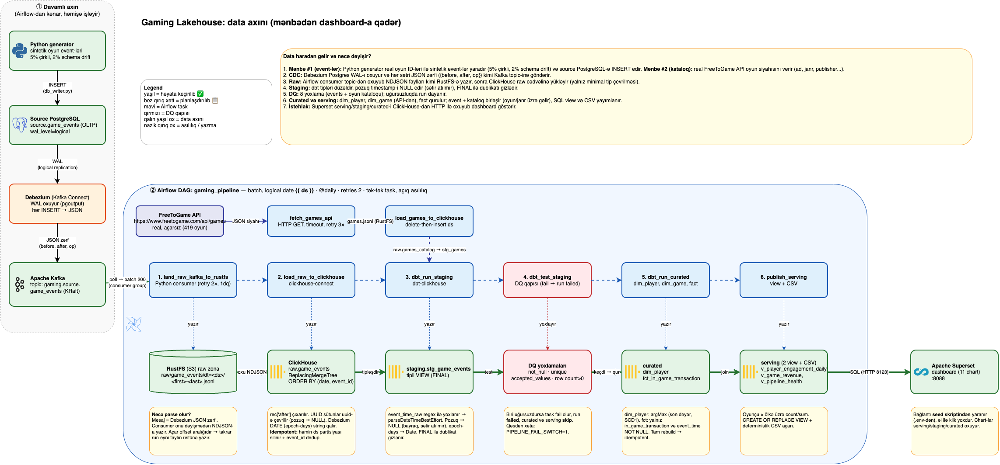

# Gaming Lakehouse Pipeline — Layihə İzahları

> Bu sənəd layihəni **biznes** və **texniki** tərəfdən tam izah edir.
> Dil: Azərbaycan · Yeniləndi: 2026-10-12 (Phase 1 uyğunluq düzəlişləri: raw delete-then-insert, işləyən `.env.example`)

---

## 1. BİZNES TƏRƏFİ

### 1.1 Hansı problemi həll edirik?

Bir oyun şirkətini təsəvvür edin: minlərlə oyunçu hər gün mobil cihazlardan oyuna girir,
bəziləri oyun içindən alış-veriş edir (mikro-tranzaksiya), bəziləri bir neçə dəqiqədən
sonra oyunu bağlayır və bir daha qayıtmır. Şirkətin qarşısında üç sual durur:

1. **Pul haradan gəlir?** — Hansı oyunlar və hansı oyunçu seqmentləri gəlir gətirir?
2. **Oyunçuları itiririk?** — Hansı mərhələdə, hansı əlamətlərlə çıxırlar (churn)?
3. **Kampaniya pulunu haraya qədirik?** — Retensiya (geri qaytarma) və marketinq
   büdcəsini hansı seqmentə yönəltmək ən çox gəlir gətirər?

Bu suallara cavab **məlumatların özündədir**, amma biznes üçün əlçatmazdır: hadisələr
oyun serverlərində (source OLTP bazasında) yaşayır, analitiklər isə daha yavaş, tarixi
sorğular üçün ayrı bir sistemdə işləməlidir. Əgər bu iki dünya arasında **etibarlı,
avtomatik axın** yoxdursa, komanda həftəlik hesabatları əl ilə SQL sorğuları və Excel
eksportları ilə yığır — həm yavaşı, həm də səhvlidir (müxtəlif insanlar müxtəlif "DAU"
rəqəmləri görür).

### 1.2 Layihə biznesə nə verir? (dəyər təklifi)

| Dəyər | İzah |
|---|---|
| **Gəlir perspektivi ilə davranış** | Sessiya (pulsuz davranış) və alış-veriş (pul) hadisələri **bir** kurasiya modelində birləşir — "hansı seqment ödəyir" sualı üç analitikin bir həftəlik əl işi yox, hazır cədvəldir. |
| **Erkən churn siqnalı** | `agg_player_daily_engagement` (Spark, Phase 3) hər oyunçunun gündəlik aktivliyini verir. Sessiya başlayıb təkrar oynamayan seqment **hələ itkin çatmayana qədər** retensiya kampaniyasına düşür — geri qaytarmaq itkinlərdən 5–25 dəfə baha başa gəlir. |
| **Büdcə sübutla bölünür** | Haftalıq Growth iclası kampaniya pulunu eyni kurasiya cədvəllərindən bölür — finance rəqəmləri ilə uzlaşan, test olunmuş, **bir** mənbədən. |
| **Bir etibarlı "player truth"** | Raw lay qeydiyyatdan keçmiş hər hadisəni itirmir (append-only), kurasiya layı dbt testləri ilə yoxlanılır. Product, finance və marketinq eyni `player_id` açarlı rəqəmləri görür. |
| **Yeni sual ucuzlaşır** | CDC axını qurulduqdan sonra yeni analitik sual ("A/B cohort-u olanlar daha çox alış edirmi?") mövcud tarixin üstündə yeni bir dbt model deməkdir — yeni bir backfill layihəsi deyil. |

**Kim istifadə edir:** Product/Growth analitik komandası (əsas), finance (uzlaşma),
özü də gələcəkdə ML komandası (churn proqnozu üçün hazırlanmış xüsusiyyətlər).

### 1.3 Biznes kimi necə istifadə olunur?

Growth analitiki səhər Superset-i açır (`http://localhost:8088`) və dashboard-da görür:
bu gün neçə event axıb, neçə alış-veriş olub, hansı ölkələrdə aktivlik artır, hansı
oyunlarda təkrar oynama düşüb. Yeni kampaniya başlayanda kampaniya ID-si ilə filtr
qoyub təsiri ölçür. Heç bir mühəndisə "mənə bu cədvəli eksport edərsən" demir.

---

## 2. ARXİTEKTURA (böyük şəkil)



> Redaktə oluna bilən mənbə: [architecture.drawio](../architecture/architecture.drawio)
> (draw.io / diagrams.net-də aç, dəyişiklikdən sonra File → Export as → PNG ilə `architecture.png`-ni yenilə).
> Aşağıdakı mətn diaqramı eyni axının sadə ASCII versiyasıdır.

```
Oyun (sintetik generator, real oyun ID-ləri)  ──►  Source PostgreSQL (OLTP)
                                                │  wal_level=logical
                                                ▼
                                           Debezium (Kafka Connect)  ── CDC ──►  Apache Kafka (topic)
                                                                                        │
                                             ┌──────────────────────────────────────────┘
                                             │ Airflow task: land_raw_kafka_to_rustfs
                                             ▼
                                        RustFS (S3-uyumlu raw zona, NDJSON fayllar)
                                             │
                                             │ Airflow task: load_raw_to_clickhouse
                                             ▼
                                        ClickHouse — RAW bazası (ReplacingMergeTree)
                                             │
  FreeToGame API (real, açarsız, 419 oyun)   │
        │ Airflow task: fetch_games_api      │
        ▼                                    │
  RustFS: raw/games_catalog/dt=<gün>/games.jsonl
        │ Airflow task: load_games_to_clickhouse
        ▼                                    │
  ClickHouse RAW: raw.games_catalog ─────────┤  (hər iki mənbə staging-ə birləşir)
                                             │
                                             │ Airflow task: dbt_run_staging
                                             ▼
                                        ClickHouse — STAGING (stg_game_events, stg_games: tipləşdirilmiş view-lar)
                                             │
                                             │ Airflow task: dbt_test_staging  ◄── DQ darvazası
                                             ▼
                                        ClickHouse — CURATED (dim_player, dim_game, fct_in_game_transaction)
                                             │
                                             │ Airflow task: publish_serving
                                             ▼
                                        ClickHouse — SERVING (v_player_engagement_daily, v_game_revenue) + RustFS-də CSV hesabatlar
                                             │
                                             ▼
                                  Apache Superset — analitik dashboard (8088)
```

**İki mənbə:** (1) event-lər: generator → Postgres → CDC → Kafka; (2) oyun kataloqu: real FreeToGame API. İkisi staging/curated qatında `game_id` ilə birləşir (oyun/janr üzrə gəlir).

**Əsas ideya:** hadisələr **axınla** (CDC) Kafka-ya çatıır; Airflow isə hər gün
(əl ilə də trigger oluna bilər) **batch** kəsimini işə salır: Kafka → RustFS →
ClickHouse → dbt → serving. Generator və CDC orkestr edilmir — onlar müstəqil,
dayanmadan işləyir (real oyundakı kimi).

### 2.1 Komponent rolu cədvəli (pipeline ↔ komponent)

| Pipeline rolu | Komponent | Status |
|---|---|---|
| Mənbə #1 (event-lər) | Python generator → source Postgres (`source.game_events`) | ✅ |
| Mənbə #2 (oyun kataloqu) | FreeToGame public API → Airflow `fetch_games_api` (ADR 0003) | ✅ |
| CDC / axın | Debezium PostgreSQL connector (Kafka Connect) | ✅ |
| Yenidən oxunaq bufer | Kafka topic `gaming.source.game_events` | ✅ |
| Raw zona (data lake) | RustFS bucket (`raw/game_events/dt=<gün>/`) | ✅ |
| Anbar | **ClickHouse** (raw / staging / curated / serving bazaları) | ✅ |
| Tipləşdirmə / kurasiya | dbt (dbt-clickhouse adapter): `stg_game_events`, `stg_games`, `dim_player`, `dim_game`, `fct_in_game_transaction` + DQ testləri | ✅ |
| Batch hesablama | Spark (Phase 1-də connectivity proof; real S3A işi Phase 3) | 📋 |
| Orkestrasiya | Airflow `gaming_pipeline` DAG (logical-date parametrli) | ✅ |
| Serving | `serving.v_player_engagement_daily` və `serving.v_game_revenue` view-ları + CSV hesabatlar | ✅ |
| Dashboard | Apache Superset (ClickHouse-a qoşulur) | ✅ |

---

## 3. TEXNİKİ DETALLAR

### 3.1 Niyə anbar olaraq ClickHouse? (PostgreSQL-dən keçid qərarı)

Phase 1-də anbar PostgreSQL 16.4 idi. Phase 2-də **ClickHouse 24.8**-ə keçid edildi.
Səbəblər:

| Meyar | PostgreSQL | ClickHouse |
|---|---|---|
| Analitik sorğu sürəti | Sətir-store: böyük `GROUP BY` / zamanda kəsiliş yığımı yavaşıdır | Sütun-store + vektor icra: milyonlarla sətirdə sayıntı/sum millisanıyələrdə |
| Aqreqasiya funksiyaları | Standart SQL | `countIf`, `uniq`, `quantile`, `argMax` — analitika üçün doğma |
| Gündəlik yükləmə nümunəsi | `INSERT ... ON CONFLICT` sətir-sətir yavaş | `client.insert` batch (row-binary) — on minlərlə saniyələrdə |
| Idempotency | `ON CONFLICT DO NOTHING` | `ReplacingMergeTree` + eyni ORDER BY açarı ilə dəyişməz-ləşdirmə |
| OLTP yükü | Yaxşı (amma bu anbar deyil, source-da qaldı) | OLTP üçün yaramaz — ona görə source PostgreSQL-də QALDI |
| dbt dəstəyi | Əla | `dbt-clickhouse` rəsmi adapteri |

**Vacib nüans:** source (mənbə) bazası PostgreSQL olaraq qalır — o, oyunun canlı OLTP
bazasını təmsil edir. ClickHouse yalnız analitik anbardır. Bu, real world şəbilərinin
düzgün ayrılmasıdır: OLTP sistemə analitik yüklə qoşulmaz.

**Keçidin təsiri kodda:** `load_raw_to_postgres` → `load_raw_to_clickhouse`
(clickhouse-connect batch insert), dbt profili `dbt-postgres` → `dbt-clickhouse`,
serving view ClickHouse dialektində. Köhnə `POSTGRES_*` dəyişənləri geriyə uyğunluq
üçün saxlanılır (deprecated).

### 3.2 ClickHouse-da cədvəl mühərriki: niyə ReplacingMergeTree?

Raw cədvəl belə yaradılır (DAG `RAW_TABLE_DDL`):

```sql
CREATE TABLE raw.game_events (...) 
ENGINE = ReplacingMergeTree
ORDER BY (source_partition_date, event_id)
```

- **ReplacingMergeTree**: eyni ORDER BY açarı ilə (`source_partition_date`, `event_id`)
  təkrar insert olunsa, merge zamanı təkrarlar bir sətrə yığılır. Merge asinxron
  olduğuna görə **əsas** idempotency mexanizmi DAG-dakı delete-then-insert-dir
  (bax 3.3); ReplacingMergeTree + staging-də `FINAL` ehtiyat qatıdır.
- Raw lay "dumb" (elə-gəldiyi-kimi) saxlanılır: `player_signup_date` Debezium-un
  göndərdiyi epoch-days int kimi **string** olaraq qalır, `source_partition_date`
  string dt açarıdır. Tipləşdirmə staging-də olur.

### 3.3 Idempotency (yenidən işə salma təhlükəsizliyi) — hər qatda

| Qat | Mexanizm |
|---|---|
| RustFS raw obyektlər | Fayl adında Kafka **offset aralığı**: `raw/game_events/dt=2026-10-09/0-199.jsonl`. Yenidən oxuyanda eyni açar üstə yazır. |
| ClickHouse raw | **Delete-then-insert**: yükləmədən əvvəl yalnız həmin `source_partition_date` partisiyası silinir (digər günlərə toxunulmur), sonra yazılır. Üstəlik run daxilində `event_id` üzrə dedup edilir (üst-üstə düşən offset aralıqları eyni event-i iki fayla sala bilər). `ReplacingMergeTree` əlavə təhlükəsizlik toru kimi qalır. Nəticə: hər run-dan sonra raw-da sətir sayı = unikal event sayı. |
| Staging | **View** (`FINAL` ilə) — həmişə raw-dan hesablanır, dublikat görünə bilməz. |
| Curated | dbt **table** materializasiyası — hər run-da tam yenidən qurulur (`CREATE OR REPLACE`). |
| Serving | `CREATE OR REPLACE VIEW` + deterministik CSV açarı (`dt=<gün>/report.csv`). |

### 3.4 Dirty record siyasəti (çirkli məlumat)

Generator təsadüfi olaraq (5–10%) pis qeydlər yaradır: null `player_id`, pozulmuş
timestamp, eksik sahələr. Siyasət:

- **Heç bir sətir atılmır.** Raw-dan staging-ə hamısı keçir.
- Pozulmuş timestamp → staging-də `event_time = NULL` (bayraq edilir, sayılır).
- `player_id` UUID-ə çevrilməyəndə → NULL (cədvəl `Nullable(UUID)`).
- **Uzlaşma hesabatı** (smoke test) fərqi izah edir: məsələn `staging 5000, fct 1681`
  fərqi = sessiya eventləri + NULL-timestamplu transaction-lar. Gizlədilmir, izahlanır.

### 3.5 DQ (Data Quality) darvazası

DAG-da `dbt_test_staging` taskı **kurated və serving-dən əvvəl** gəlir — testlər
keçməsə, downstream tasklar skip olunur və run `failed` işarələnir. Mövcud yoxlamalar:

1. `not_null(stg_game_events.event_id)` — PK boş ola bilməz
2. `unique(stg_game_events.event_id)` — dedup doğruluğu
3. `accepted_values(event_type ∈ {session_start, session_end, in_game_transaction})`
4. `assert_staging_has_rows` (singular test) — boş raw üzərində run yayımlanmır
5. `not_null` + `unique` `stg_games.game_id`, `not_null` `stg_games.title` — API kataloqunun bütövlüyü
6. `assert_games_catalog_has_rows` — API boş qaytarsa run dayanır

Bunlardan biri uğursuz olsa run **failed** olur. Qeyd: `schema.yml`-də curated
modellər üçün də `not_null/unique` testləri təyin olunub (`dim_player.player_id`,
`fct.event_id`), amma DAG hazırda yalnız `dbt test --select staging` işlədir —
curated testlər əl ilə (`dbt test --select curated`) işlədilir. TODO.

---

### 3.6 Logical-date parametrasiyası

DAG bütün tasklarda Airflow templating dəyişəni `{{ ds }}` (run-un logical tarixi)
işlədir: consumer `dt=<ds>` partisiyasına yazır, raw loader həmin günün obyektlərini
yükləyir, serving CSV `dt=<ds>` açarına gedir. Nəticə: **hansı gün üçün işlədiyini
bilmək üçün komanda tarixçəsinə baxmaq kifayətdir** və köhnə günü yenidən
(reprocess) etmək üçün həmin tarixə trigger etmək bəs edir.

### 3.7 Airflow task qrafı

```
land_raw_kafka_to_rustfs ─► load_raw_to_clickhouse ─┐
fetch_games_api ─► load_games_to_clickhouse ───────┴─► dbt_run_staging ─► dbt_test_staging ─► dbt_run_curated ─► publish_serving
spark_connectivity_proof (paralel)
```

- **land_raw_kafka_to_rustfs**: Kafka istehlakçısı bounded işləyir — `max_batches=25`
  (≤5000 mesaj) + `idle_exit_seconds=20` (yeni mesaj gəlməsə dayan). Bu, Airflow
  taskının sonsuz qalmaması üçündür.
- **PIPELINE_FAIL_SWITCH=1** (.env-də): qəsdən xəta demo — ingestion taskı
  `AirflowFailException` atır, hamı downstream skip. Reviewer üçün sənədləşdirilib.
- **fetch_games_api** (ikinci mənbə): real FreeToGame API-dən (`https://www.freetogame.com/api/games`,
  açar tələb etmir) oyun kataloqunu çəkir: timeout, 3 daxili cəhd (backoff) və Airflow
  səviyyəsində 3 retry. Cavab validasiya olunur (`id`, `title` məcburi), RustFS-ə
  `raw/games_catalog/dt=<ds>/games.jsonl` kimi yazılır. API düşərsə run uğursuz olur
  (sınaq: `.env`-də `FREETOGAME_API_URL=http://127.0.0.1:1/x`). Qərarın əsası: `docs/decisions/0003-games-api-second-source.md`.
- **load_games_to_clickhouse**: `raw.games_catalog`-a delete-then-insert (həmin tarix üçün).
- Retry siyasəti: Kafka task-ı 2, games API task-ı 3, qalanları 2 dəfə; hamısı 1 dəqiqə fasilə ilə.

### 3.8 Spark: niyə hələlik yalnız connectivity proof?

Phase 1 tələbi: hər komponent ya **pipeline-da istifadə olunur**, ya da
**sənədləşdirilmiş connectivity proof ilə örtülür**. Spark üçün real S3A batch işi
Phase 3-dür (RustFS-dən oxuyub `agg_player_daily_engagement` yazır); Phase 1-də
`spark_connectivity_proof` taskı Spark konteynerində real `spark-submit` işlədir
(HOME/ivy problemi həll edilmiş). Tam əsaslandırma: `docs/decisions/0001-spark-batch-s3a-phase3.md`.

### 3.9 Təhlükəsizlik və gizli məlumatlar

- Heç bir real secret repoda yoxdur: `.env` gitignore-dadır. `.env.example` yalnız **lokal dev** üçün nümunə dəyərlər saxlayır (dəyişmədən işləyir); paylaşılan mühitdə mütləq dəyişdirilməlidir.
- dbt profili `env_var()` ilə işləyir — repoya kommit oluna bilər.
- Airflow container-ların docker socket-i **read-only** mount-dur (yalnız Spark proof).
- Bütün qoşulma məlumatları (host, port, bucket, parol) mərkəzi `config/settings.py` vasitəsilə `.env`-dən oxunur; kodda sabit dəyər yoxdur.

### 3.10 CI (GitHub Actions)

`.github/workflows/ci.yml`: hər PR/main push-da:
1. `ruff check .` — lint
2. `python -m compileall` — bütün modullar kompilyasiya olunur
3. `docker compose config --quiet` (`.env.example` ilə) — infrastruktur tərifi etibarlıdır
4. `pytest` — vahid testlər (generator, dbt layihə strukturu)

---

### 3.11 Data modeli

| Qat | Obyekt | Dənə (1 sətir =) | Əsas sütunlar |
|---|---|---|---|
| Source #1 | `source.game_events` (Postgres) | 1 event | `event_id` (PK), `event_type`, tarix, oyunçu/cihaz/oyun sahələri |
| Source #2 | FreeToGame API (`/api/games`) | 1 oyun | `id`, `title`, `genre`, `platform`, `publisher`... |
| Raw | `raw.game_events` | 1 event | mənbə sütunları + `source_partition_date`, `loaded_at` |
| Staging | `staging.stg_game_events` (view) | 1 event | tipləşdirilmiş `event_time` (pozuqsa NULL), `player_signup_date` (Date) |
| Raw (API) | `raw.games_catalog` | 1 oyun / gün snapshot | `game_id`, `title`, `genre`, `publisher`, `source_partition_date` |
| Staging (API) | `staging.stg_games` (view) | 1 oyun (son snapshot) | tipləşdirilmiş `release_date` |
| Curated | `curated.dim_game` | 1 oyun | `game_id`, `title`, `genre`, `platform`, `publisher` (SCD1) |
| Curated | `curated.dim_player` | 1 oyunçu | `player_id`, `display_name`, `country`, `signup_date` (SCD1: son dəyər qalib) |
| Curated | `curated.fct_in_game_transaction` | 1 alış-veriş | `event_id`, `player_id`, `game_id`, `session_id`, `amount_usd`, `currency`, `event_time` |
| Serving | `serving.v_player_engagement_daily` (view) | oyunçu × ölkə | `transactions`, `total_amount_usd`, `last_txn_at` |
| Serving | `serving.v_game_revenue` (view) | oyun | `title`, `genre`, `publisher`, `transactions`, `paying_players`, `revenue_usd` |

Phase 1-də naiv qərarlar (sənədləşdirilmiş TODO): mənfi məbləğlər fact-da saxlanır,
`dim_player` SCD2 deyil.

---

## 4. SUPERSET DASHBOARD (analitik panel)

### 4.1 Niyə Superset?

Müqayisə (anbar analitika dashboard-ları üçün):

| Alət | Artıqlıq | Çatışmazlıq (bizim kontekstdə) |
|---|---|---|
| **Apache Superset** ✅ | Açıq kod, ClickHouse üçün rəsmi driver, "anlıq" chart avto-yenilənməsi (auto-refresh), SQL Lab (sorğu editing), pulsuz | İlk quraşdırma bir az çətin (indi compose ilə bir əmrdədir) |
| Metabase | Ən asan UI | ClickHouse rəsmi driver deyil (plugin), anlıq avto-refresh zəifdir |
| Grafana | Ən yaxşı "live" panellər | Daha çox metrik/alert_tool; analitik cədvəllər üçün Superset-dən əskidir |
| Tableau/PowerBI | Enterprise | Pul, lisenziya, dərs layihəsi üçün ağır |

"Anlıq event görmək" tələbi üçün Superset-in chart-level **auto-refresh** (10s/30s)
yete r: son N dəqiqənin event sayı, ölkə bazasında aktivlik, transaksiya həcmi
canlı yenilənir (mənbə: ClickHouse-dan birbaşa sorğu — sürətli, saniyələşdirilmiş gecikmə).

### 4.2 Quraşdırma (repodan təkrarlana bilən)

Əl ilə "klik-klik" qurulmur — hamısı koddadır:

1. `make up` — `superset-init` konteyneri migrasiyanı edir, admin istifadəçi yaradır
   (login: `.env`-də `SUPERSET_ADMIN_USER` / `SUPERSET_ADMIN_PASSWORD`).
2. **Pipeline ilk dəfə işlədikdən sonra** (`make smoke`) `make seed-superset` — dataset-lər pipeline-ın yaratdığı cədvəllərdən oxuyur, onlar olmadan chart-lar boş çıxır. [scripts/superset_seed.py](../../scripts/superset_seed.py)
   ClickHouse bağlantısını, dataset-ləri, 6 chart-ı və
   "Gaming Lakehouse — Live Overview" dashboard-unu yaradır (idempotent).
3. Aç: `http://localhost:8088`.

Seed edilən chart-lar (nümunə): "Events over time (last 24h)", "Events by type
(last 24h)", "Revenue by country (all time)", "Transactions per hour (last 7 days)"
və s. Mənbələr: `staging.stg_game_events`, `curated.fct_in_game_transaction`,
`serving.v_player_engagement_daily`.

### 4.3 "Anlıq" necə işləyir (dürüst gecikmə hesabatı)

Axın gecikməsi = generator→Debezium (saniyələr) + consumer batch (200 mesaj və ya
20s idle) + Airflow run intervalı. Dashboard **canlıya yaxın**dır: son dəqiqələrin
event-ləri bir neçə dəqiqəyə dashboard-da görünür (batch arxitekturasının təbiəti).
Tam saniyə-saniyə canlılıq Phase 2+ streaming kəsimi (Kafka → ClickHouse push)
ilə gələcək.

---

## 5. SIFIRDAN NECƏ İŞƏ SALMAQ (addım-addım)

### 5.1 Tələblər

- Docker + Docker Compose v2, ~8 GB boş RAM
- Python 3.11+ (generator, smoke test və testlər host-da `.venv` ilə işləyir)
- `make`, `curl`, `envsubst` (macOS: `brew install gettext`)

### 5.2 Quraşdırma

```bash
git clone <repo-url> && cd gaming-data-pipeline-e2e
cp .env.example .env                       # redaktə lazım deyil (lokal dev dəyərləri)

python3 -m venv .venv && source .venv/bin/activate
pip install -r requirements.txt            # make generate / make smoke bunu istifadə edir

make up                                    # stack qalxır (ilk dəfə Airflow image build ~3-5 dəq)
make ps                                    # hamısı "healthy" olana qədər gözlə
make register-connector                    # Debezium CDC (idempotent)
# make seed-superset  → pipeline ilk dəfə işlədikdən SONRA (aşağıya bax)
```

### 5.3 Pipeline-ı işə salmaq

```bash
make smoke                                 # hər şeyi edir: event yaradır, DAG-ı trigger edir, hər qatı yoxlayır
SMOKE_DS=2026-10-11 make smoke             # konkret logical date üçün
```

Və ya addım-addım:

```bash
make generate COUNT=5000 RATE=1000         # source-a event yaz
make rerun                                 # DAG-ı bugün üçün trigger/re-run et (və ya Airflow UI)
```

Gözlənilən nəticə: Airflow-da `gaming_pipeline` run-u `success`, smoke sonunda
"reconciliation OK" və "smoke PASSED". Hər qat üçün say cədvəli çıxır.

### 5.4 Yoxlama

```bash
docker exec gaming-clickhouse clickhouse-client --query "
  SELECT 'raw', count(*) FROM gaming_lakehouse.raw.game_events
  UNION ALL SELECT 'staging', count(*) FROM gaming_lakehouse.staging.stg_game_events
  UNION ALL SELECT 'fct', count(*) FROM gaming_lakehouse.curated.fct_in_game_transaction
  UNION ALL SELECT 'serving', count(*) FROM gaming_lakehouse.serving.v_player_engagement_daily"
```

Loglar: Airflow UI → `gaming_pipeline` → task → Logs, və ya
`docker logs gaming-airflow-scheduler`. Hər task start/end, input/output və sətir
sayını yazır.

### 5.5 Qəsdən xəta demosu

```bash
# .env-də PIPELINE_FAIL_SWITCH=1 et, sonra:
make up                                    # Airflow konteynerləri yenidən yaranır
make rerun                                 # land_raw_kafka_to_rustfs fail, qalan tasklar skip, run = failed
# geri: PIPELINE_FAIL_SWITCH=0 + make up
```

### 5.6 Dayandırma / restart / sıfırlama

```bash
make down      # dayandır, data qalır (named volumes)
make up        # yenidən qaldır — əvvəlki nəticələr yerindədir, pipeline yenidən işləyir
make clean     # TAM sıfırlama: bütün volume-lar silinir
```

> **`make clean` + `make up` sonrası:** hər şey sıfırdan başlayır (data, connector
> qeydiyyatı, Superset dashboard). Yenidən `make register-connector`,
> `make seed-superset` və `make smoke` (yeni event yaradır) lazımdır.

Brauzerlər: Airflow `8080` · Superset `8088` · Kafka UI `8085` · Spark UI `8081` ·
RustFS konsol `9001` · ClickHouse HTTP `8123`.

### 5.7 Tez-tez rast gəlinən problemlər

- `make generate` / `make smoke` "`.venv/bin/python` yoxdur" deyirsə — 5.2-dəki venv + pip addımı atlanıb.
- Run `None` vəziyyətində qalırsa — DAG paused ola bilər (`make smoke` onu avtomatik unpause edir).
- Smoke "raw < 1000" deyirsə — connector qeydiyyatdan keçməyib (`make register-connector`) və ya Kafka-ya event çatmayıb.

---

## 6. FAZALAR VƏ STATUS

| Faza | Əhatə | Status |
|---|---|---|
| Phase 0 | İnfrastruktur + skeleton | ✅ |
| Phase 1 | Walking skeleton: Kafka→RustFS→raw→dbt→serving, DQ, smoke, CI | ✅ |
| Phase 2 | **ClickHouse anbarı + Superset dashboard** (bu dəyişiklik) | ✅ |
| Phase 3 | Real Spark S3A batch (`agg_player_daily_engagement`) | 📋 |
| Phase 4 | Streaming kəsimi + BI/ML genişlənmə | 📋 |

## 7. Risklər və qeydlər

- `bitnamilegacy/spark:3.5.3` — Bitnami 2025 registry dəyişikliyi səbəbilə legacy
  repo; Phase 3-də rəsmi `apache/spark` image-ə keçid tövsiyə olunur.
- Superset image-ə `clickhouse-connect` boot-da pip ilə quraşdırılır (ilk start
  internet tələb edir). Tam offline üçün custom image tövsiyə olunur.
- ClickHouse host port 9004 ← konteyner 9000 (RustFS 9000-i tutur).
- LocalExecutor birdən çox taskı paralel işə sala bilir; tasklar müstəqil
  idempotent olduğundan təhlükəsizdir.
